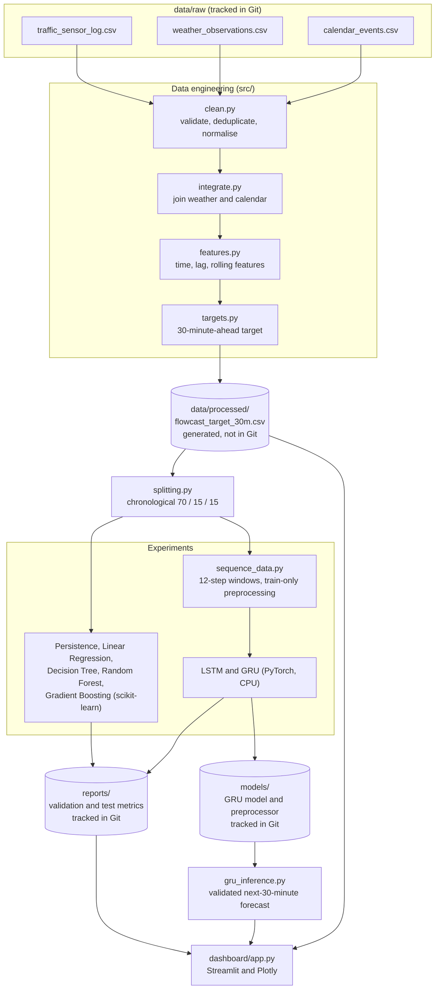

# FLOWCAST

**AI-driven traffic analytics and 30-minute volume forecasting, built on a leakage-aware ML pipeline and an interactive Streamlit dashboard.**


Traffic operators usually see congestion after it has formed. FLOWCAST works with historical sensor, weather and calendar data for a 25-segment road corridor, builds a clean modelling table from it, and trains models that predict each segment's traffic volume **30 minutes ahead**. A Streamlit dashboard lets you explore the historical data, run the saved GRU model, and inspect how every model performed.

This is an offline, historical-data project. It is not connected to live sensors, and the forecast target is traffic volume only. See [Implementation status](#implementation-status) and [Limitations](#limitations-and-known-issues) for the exact scope.

> **Fresh-clone note:** the processed modelling dataset is excluded by `.gitignore`. After cloning, five of the six dashboard pages need you to regenerate it first (under a minute). See [Installation](#installation-and-local-setup) and [Deployment](#deployment).

## Contents

- [Project overview](#project-overview)
- [Implementation status](#implementation-status)
- [System architecture](#system-architecture)
- [Technology stack](#technology-stack)
- [Dataset and data engineering](#dataset-and-data-engineering)
- [Machine learning methodology](#machine-learning-methodology)
- [Model performance](#model-performance)
- [Inference workflow](#inference-workflow)
- [Dashboard walkthrough](#dashboard-walkthrough)
- [Project structure](#project-structure)
- [Installation and local setup](#installation-and-local-setup)
- [Testing](#testing)
- [Deployment](#deployment)
- [Limitations and known issues](#limitations-and-known-issues)
- [Roadmap](#roadmap)
- [Engineering decisions](#engineering-decisions)
- [License and data provenance](#license-and-data-provenance)
- [Live link: https://flowcast-traffic-ai.streamlit.app/]
- [Author](#author)

## Project overview

**The problem.** Signal plans and incident response are typically reactive. A short-horizon forecast of how busy each road segment will be gives operators something to plan against instead of something to react to.

**What FLOWCAST does.** Given the recent history of one road segment, it predicts the traffic volume (vehicles per 30-minute window) for the *next* 30-minute window.

**How the pieces fit together:**

1. **Data pipeline** (`src/clean.py`, `integrate.py`, `features.py`, `targets.py`) turns three raw CSV tables into one modelling table with lag, rolling and calendar features and a 30-minute-ahead target.
2. **Experiments** compare a persistence baseline and four scikit-learn regressors against two PyTorch recurrent models (LSTM and GRU), all using the same chronological split.
3. **Inference** (`src/gru_inference.py`) loads the saved GRU and its preprocessor and forecasts from a validated 12-step history window.
4. **Dashboard** (`dashboard/`) reads the processed data, the saved GRU artifacts and the evaluation reports, and presents them with Plotly.

## Implementation status

| Capability | Status | Notes |
|---|---|---|
| Data cleaning, deduplication, source integration | Implemented | Run via `python -m src.clean` |
| Time, lag and rolling feature engineering | Implemented | Past-only features, exact timestamp matching |
| 30-minute-ahead volume target | Implemented | `traffic_volume_target_30m` |
| Persistence, Linear Regression, Decision Tree, Random Forest, Gradient Boosting | Implemented | Validation reports committed |
| LSTM and GRU volume models (PyTorch, CPU) | Implemented | Validation reports committed |
| Final test evaluation | Implemented for **GRU only** | Reproduced from the committed model |
| GRU inference with input validation | Implemented | Next 30 minutes, one road at a time |
| Streamlit dashboard (6 pages) | Implemented | Needs the regenerated processed dataset |
| Forecast horizons of 60-120 minutes | Not implemented | Only +30 minutes |
| Speed, travel-time and accident-risk forecasting | Not implemented | Fields exist in the raw data; no models |
| Congestion-level classification | Not implemented | Observed labels are visualised; no classifier |
| Prediction confidence or uncertainty | Not implemented | |
| Live sensor ingestion or serving API | Not implemented | Dashboard runs on historical data only |

## System architecture



| Component | Responsibility |
|---|---|
| `src/clean.py`, `src/integrate.py` | Validate raw tables, remove exact duplicates, null invalid measurements, derive missing congestion labels with provenance, normalise weather labels, join weather (station and hour) and calendar (date). |
| `src/features.py`, `src/targets.py` | Add calendar, lag and rolling features and the +30-minute target, matching by `(road_id, timestamp)` rather than row position. |
| `src/splitting.py`, `src/selection.py`, `src/preprocessing.py` | Chronological split on unique timestamps, explicit feature allowlist, train-fitted imputation and encoding. |
| `src/sequence_data.py`, `src/dl_models.py`, `src/dl_training.py` | Contiguous 12-step windows, LSTM and GRU regressors, training loop with early stopping and learning-rate scheduling. |
| `src/compare_all_models.py`, `src/evaluate_final_test.py` | Aligned validation comparison and the single held-out GRU test evaluation. |
| `src/gru_inference.py` | Loads saved artifacts and serves a validated next-interval forecast. |
| `dashboard/` | Cached data access, report loading and the six-page Streamlit UI. |

There is no database, REST API, message queue or cloud service in this project.

## Technology stack

| Layer | Technology | Actual usage |
|---|---|---|
| Language | Python | All pipeline, training, inference and dashboard code |
| Data | pandas, NumPy | Cleaning, joins, exact-timestamp lag and rolling features, sequence windows |
| Classical ML | scikit-learn | `LinearRegression`, `DecisionTreeRegressor`, `RandomForestRegressor`, `GradientBoostingRegressor`; median imputation, one-hot encoding, standard scaling |
| Deep learning | PyTorch (CPU build) | Unidirectional `nn.LSTM` and `nn.GRU` regressors; Adam, MSE loss, `ReduceLROnPlateau` |
| Dashboard | Streamlit | Six-page app, cached data and model loading |
| Visualisation | Plotly | Area, line, bar and heatmap charts in the dashboard |
| Visualisation | Matplotlib | Training-curve figures written by the training code |
| Configuration | PyYAML | `config.yaml` paths, column names, rush-hour intervals, seed |
| Persistence | joblib | Saving and loading preprocessors and classical models |
| Testing | pytest | Unit and integration tests (not listed in `requirements.txt`; install separately) |

XGBoost was considered during development but is not installed or used; Gradient Boosting uses scikit-learn's implementation.

## Dataset and data engineering

### Sources

The project uses the **Northline Corridor** dataset: three linked tables kept unchanged in `data/raw/`. Field definitions are in `project_reference/FlowCast_Data_Dictionary.docx`.

| Table | Grain | Raw rows |
|---|---|---:|
| `traffic_sensor_log.csv` | Road segment x 30 minutes (25 segments, `NL-001` to `NL-025`) | 178,468 |
| `weather_observations.csv` | Station x hour | 10,872 |
| `calendar_events.csv` | Date | 151 |

Traffic observations span **1 January to 31 May 2025** at 30-minute resolution. The data is historical; it does not establish a live feed.

### Cleaning and integration

Figures below come from `reports/data_quality.md` and were reproduced by re-running the pipeline.

| Step | Result |
|---|---|
| Exact duplicate traffic rows removed | 1,767 (no conflicting duplicate keys) |
| Cleaned, integrated dataset | 176,701 rows |
| Invalid measurements set to missing | 704 values (volume 239, speed 236, occupancy 229) |
| Missing `traffic_volume` after cleaning | 4,587 rows (2.60%); not imputed |
| Missing congestion labels derived from valid inputs | 25,943 (original labels never overwritten) |
| Weather join | 176,701 of 176,701 rows matched (station ID + timestamp floored to the hour) |
| Calendar join | 176,701 of 176,701 rows matched (151 dates) |
| Absent 30-minute windows | 4,499; longest gap 2 windows (1 hour) |
| Weather label normalisation | e.g. `CLEAR`, `clear` mapped to `Clear` |

Raw file hashes are checked before and after processing to confirm the raw inputs are untouched.

### Features and target

The final modelling table has **176,701 rows and 46 columns**.

| Feature group | Columns |
|---|---|
| Calendar | `hour_of_day`, `day_of_week`, `is_weekend`, `month`, `is_rush_hour` (07:00-09:59 and 16:00-18:59) |
| Lag | `traffic_volume_lag_1` (t - 30 min), `traffic_volume_lag_2` (t - 60 min) |
| Rolling | `traffic_volume_rolling_mean_3`, `traffic_volume_rolling_mean_6` (past-only means over t - 30 to t - 90 and t - 30 to t - 180 minutes) |
| Target | `traffic_volume_target_30m`: the valid volume of the same road exactly 30 minutes after each row |

**Target missingness:** 8,894 rows have no 30-minute-ahead target (missing, invalid, or no row at t + 30). They are excluded from training and evaluation rather than filled.

### Temporal alignment and leakage prevention

- Lags, rolling means and targets are looked up by `(road_id, timestamp)`, never by row position, so a gap in the data cannot silently pull a neighbouring row.
- Rolling features use earlier timestamps only.
- The target column is rejected as a model input by `src/selection.py`, the sequence builders, the inference code and the dashboard loader.
- Imputers, scalers and encoders are fitted on training rows only.
- Splits are chronological (see below), so validation and test always lie in the future of training.

## Machine learning methodology

**Target.** Traffic volume of the same road segment 30 minutes after the reference timestamp.

**Split.** Chronological 70 / 15 / 15 on unique timestamps, so all rows sharing a timestamp stay together.

| Partition | Period | Rows |
|---|---|---:|
| Train | 2025-01-01 00:00 to 2025-04-16 16:00 | 123,716 |
| Validation | 2025-04-16 16:30 to 2025-05-09 07:30 | 26,482 |
| Test | 2025-05-09 08:00 to 2025-05-31 23:30 | 26,503 |

### Models

| Model | Inputs | Configuration |
|---|---|---|
| Persistence baseline | `traffic_volume_lag_1` | No fitting; predicts the lag-1 value |
| Linear Regression | 11 tabular features | scikit-learn defaults |
| Decision Tree | 11 tabular features | `random_state=42` |
| Random Forest | 11 tabular features | 50 trees, `max_depth=20`, `min_samples_leaf=2`, `random_state=42` |
| Gradient Boosting | 11 tabular features | 100 estimators, learning rate 0.05, depth 3, `min_samples_leaf=5`, `subsample=0.8` |
| LSTM | 12 x 30-minute window | 1 layer, 32 hidden units, dropout 0.2 |
| GRU | 12 x 30-minute window | 1 layer, 32 hidden units, dropout 0.2 |

- **Tabular feature set (11):** `road_id`, `road_capacity`, the two lags, the two rolling means and the five calendar features.
- **Recurrent input:** the previous 12 half-hour observations (6 hours) of `traffic_volume`, `avg_speed`, `occupancy`, `weather_temperature`, `weather_rainfall`, `weather_visibility` and the five calendar features, plus a one-hot road identifier (36 input channels in total). Windows must be exactly contiguous at 30 minutes.
- **Recurrent training:** Adam (learning rate 1e-3), MSE loss, batch size 64, up to 50 epochs with early-stopping patience 7 and `ReduceLROnPlateau`, seed 42. For both models the best validation epoch was 49 of the 50-epoch cap, so early stopping never triggered and longer training might help.
- **Preprocessing:** median imputation then standard scaling for numeric inputs and one-hot encoding for roads, all fitted on training data only.
- **Selection:** the GRU was chosen as the primary candidate because it led the common validation comparison on RMSE, MAE and R². The test partition was used only for the final GRU evaluation.

Every model predicts the same quantity (volume at t + 30 minutes). Only the GRU has an inference interface and a final test evaluation.

## Model performance

All numbers are **historical offline results** from the committed reports in [`reports/`](reports). They are not guarantees of future performance.

### Validation results

| Model | RMSE | MAE | MAPE | R² | Validation rows |
|---|---:|---:|---:|---:|---:|
| Persistence baseline | 158.48 | 111.88 | 25.55% | 0.6765 | 23,857 |
| Linear Regression | 122.30 | 93.14 | 25.70% | 0.8071 | 25,141 |
| Decision Tree | 90.87 | 61.33 | 14.76% | 0.8935 | 25,141 |
| Random Forest | 63.17 | 42.86 | 10.37% | 0.9486 | 25,141 |
| Gradient Boosting | 81.34 | 55.98 | 14.33% | 0.9147 | 25,141 |
| LSTM | 56.23 | 38.76 | 9.70% | 0.9590 | 18,704 |
| GRU | 55.92 | 38.71 | 9.82% | 0.9595 | 18,704 |

**Read this table carefully.** The rows are not identical across models. Tabular models are scored on every validation row with a valid target (25,141; 23,857 for persistence, which also needs a valid lag). The recurrent models need 12 contiguous observations, so they are scored on 18,704 rows. For a like-for-like view, `reports/all_models_validation_comparison.json` aligns Random Forest, LSTM and GRU on the same 18,704 rows by road, timestamp and actual target:

| Model (common 18,704 validation rows) | RMSE | MAE | MAPE | R² |
|---|---:|---:|---:|---:|
| Random Forest | 62.58 | 42.50 | 10.29% | 0.9492 |
| LSTM | 56.23 | 38.76 | 9.70% | 0.9590 |
| GRU | 55.92 | 38.71 | 9.82% | 0.9595 |

The dashboard's Model Performance page shows these common-subset values for Random Forest, LSTM and GRU. The GRU leads on RMSE, MAE and R², while the LSTM is slightly better on MAPE.

### Final GRU test results

Evaluated once on the held-out test partition (2025-05-09 08:00 to 2025-05-31 23:30) with preprocessing fitted on training rows only.

| Metric | Value |
|---|---:|
| RMSE | 61.4293 |
| MAE | 40.8458 |
| MAPE | 10.1584% |
| R² | 0.9549 |

18,640 test windows were scored; 7,863 of 26,503 test rows were excluded (275 insufficient history, 6,548 non-contiguous timestamps, 1,040 missing target). Re-running `python -m src.evaluate_final_test` against the committed model and a regenerated dataset reproduces these figures to within 1e-6.

### Metric definitions

- **RMSE / MAE:** error in vehicles per 30-minute window; lower is better. RMSE penalises large misses more.
- **MAPE:** mean absolute percentage error; rows with a zero actual value are excluded.
- **R²:** share of variance explained; higher is better.

### How to interpret the comparison

The tabular models and the persistence baseline receive `traffic_volume_lag_1` (volume at t - 30 min) but not the volume at the reference timestamp t itself. The recurrent windows do include the volume at t. The GRU and LSTM therefore see more recent information than the baseline and the tabular models, and the persistence baseline is effectively a 60-minute-ahead persistence. This is not leakage, but it means the gap between the recurrent and tabular models is not purely an architecture effect. A persistence baseline built from the current volume is on the [roadmap](#roadmap).

## Inference workflow

Implemented in [`src/gru_inference.py`](src/gru_inference.py).

1. Load the saved GRU weights and the fitted preprocessor (`models/gru_volume_model.pt`, `models/gru_volume_preprocessor.joblib`), checking sequence length, feature columns and input size.
2. Pass a DataFrame of historical observations for **one** supported road.
3. Validation rejects: a `traffic_volume_target_30m` column, missing required columns, invalid timestamps, missing or unknown road IDs, duplicate road-timestamp keys, more than one road, fewer than 12 rows, and a final 12-row window that is not exactly 30 minutes apart.
4. The last 12 contiguous half-hour rows are transformed with the saved preprocessor (missing numeric values use the saved median imputation).
5. The GRU returns the road ID, the forecast timestamp (latest observation + 30 minutes) and the predicted volume.

```python
import pandas as pd
from src.gru_inference import GRUInference
from src.sequence_data import DL_NUMERIC_FEATURE_COLUMNS

df = pd.read_csv("data/processed/flowcast_target_30m.csv", parse_dates=["timestamp"])

# Required columns: road_id, timestamp and the 11 numeric inputs
columns = ["road_id", "timestamp", *DL_NUMERIC_FEATURE_COLUMNS]
road = df.loc[df["road_id"] == "NL-001", columns].dropna().sort_values("timestamp")

# Take the latest run of exactly-contiguous 30-minute rows
runs = road["timestamp"].diff().ne(pd.Timedelta(minutes=30)).cumsum()
history = [g for _, g in road.groupby(runs) if len(g) >= 12][-1].tail(12)

predictor = GRUInference.from_artifacts()
result = predictor.predict_next_30_minutes(history)
print(result)
# GRUPrediction(road_id='NL-001',
#               forecast_timestamp=Timestamp('2025-05-31 19:30:00'),
#               predicted_traffic_volume=454.35...)
```

`GRUPrediction` is a frozen dataclass with `road_id`, `forecast_timestamp` and `predicted_traffic_volume`. The example output above was produced by running this snippet against the regenerated dataset.

This is **historical-window inference**, not a live traffic service. Nothing in the repository ingests sensor data in real time.

## Dashboard walkthrough

Start it with `python -m streamlit run dashboard/app.py` (see [Installation](#installation-and-local-setup)). The repository does not currently contain screenshots.

| Page | Purpose | Main output |
|---|---|---|
| Overview | Network-level summary of the historical record | KPI tiles (observations, road segments, average volume and speed), daily volume area chart, volume-by-hour bar chart |
| Road Forecast | Run the saved GRU for a chosen road | Predicted volume for the next 30-minute interval, forecast context (road, interval, latest input, 12 x 30 min sequence), observed-history-to-forecast line chart |
| Historical Analytics | Explore observed volume and speed | Date range, road and daily/hourly aggregation filters; KPI tiles; volume and speed line charts |
| Congestion Heatmap | See where and when congestion was observed | Road x hour heatmap of the mean observed congestion category (Free-flow to Severe) with date and road filters |
| Road Comparison | Compare segments side by side | Multi-road selector, summary table, average-volume and average-speed bar charts |
| Model Performance | Compare all trained approaches | Validation metrics table and charts, road-level comparison for the five non-recurrent approaches, final GRU test metrics |

Notes on scope:

- Road Forecast uses the latest valid contiguous 12-step window found in the dataset, so it forecasts the interval right after the end of the historical record (31 May 2025). It does not show the actual outcome.
- Per-row predictions are saved only for the baseline and the four scikit-learn models, so road-level metrics on the Model Performance page exclude LSTM and GRU.
- Every page labels its data as historical and not live.

## Project structure

```text
FLOWCAST-AI-Traffic-Analytics-Platform/
├── config.yaml                 # Paths, column names, rush-hour intervals, seed
├── requirements.txt
├── dashboard/
│   ├── app.py                  # Streamlit entry point (six pages)
│   ├── data_access.py          # Cached, validated data and report loading
│   └── model_performance.py    # Report loading for the Model Performance page
├── src/
│   ├── clean.py, integrate.py  # Validation, cleaning, source integration
│   ├── features.py, targets.py # Feature engineering and 30-minute target
│   ├── splitting.py, selection.py, preprocessing.py
│   ├── baseline.py, train_*.py # Persistence and scikit-learn trainers
│   ├── sequence_data.py, dl_models.py, dl_training.py
│   ├── train_lstm.py, train_gru.py
│   ├── compare_*.py, evaluate_final_test.py, regenerate_validation_reports.py
│   ├── create_validation_comparison.py, run_baseline_evaluation.py
│   ├── gru_inference.py        # Saved-GRU inference
│   └── inspect_data.py, utils.py
├── tests/                      # 21 pytest modules (150 tests)
├── notebooks/                  # 03_eda.ipynb is the populated notebook
├── reports/                    # Metrics (JSON/MD), data quality and EDA reports
├── models/                     # Tracked: GRU model, checkpoint, preprocessor, history
├── data/
│   ├── raw/                    # Tracked source CSVs
│   ├── interim/                # Generated, ignored by Git
│   └── processed/              # Generated, ignored by Git
└── project_reference/          # PRD and data dictionary (.docx)
```

| Location | In Git? | Notes |
|---|---|---|
| `data/raw/*.csv` | Yes | About 31 MB, mostly the traffic log |
| `data/interim/`, `data/processed/` | **No** (only `.gitkeep`) | Regenerate with the pipeline commands below |
| `models/gru_volume_*` | Yes | Four GRU files, force-added despite the `models/*` ignore rule |
| `models/` (LSTM and scikit-learn artifacts) | **No** | Created when you run the trainers |
| `reports/*.json`, `*.md`, `validation_prediction_comparison.csv` | Yes | Source of the numbers in this README |
| `reports/figures/` | **No** (only `.gitkeep`) | Training-curve PNGs are generated |

Notebooks `01_eda`, `02_cleaning` and `03_modelling` are single-cell placeholders; the analysis notebook is `03_eda.ipynb`, summarised in `reports/eda_findings.md`.

## Installation and local setup

Requires Python 3.11 or newer (3.13 was used to verify this README).

```bash
git clone https://github.com/ChanduChowday25/FLOWCAST-AI-Traffic-Analytics-Platform.git
cd FLOWCAST-AI-Traffic-Analytics-Platform

python -m venv .venv
```

Activate the environment:

```powershell
# Windows PowerShell
.venv\Scripts\Activate.ps1
```

```bash
# macOS / Linux
source .venv/bin/activate
```

Install dependencies:

```bash
python -m pip install --upgrade pip
pip install -r requirements.txt
pip install pytest   # only needed to run the tests
```

`requirements.txt` pins `torch==2.14.1+cpu` and adds the PyTorch CPU wheel index (`--extra-index-url https://download.pytorch.org/whl/cpu`), so the machine needs access to that index.

### Regenerate the processed dataset

The dashboard's data pages and the training scripts read `data/processed/flowcast_target_30m.csv`, which is not committed. Build it from the committed raw files:

```bash
python -m src.clean                # cleaning + integration -> data/processed/flowcast_clean.csv
python -m src.features             # time features
python -c "from src.features import run_lag_feature_pipeline; run_lag_feature_pipeline()"
python -c "from src.features import run_rolling_feature_pipeline; run_rolling_feature_pipeline()"
python -m src.targets              # -> data/processed/flowcast_target_30m.csv
```

`src.features` exposes a command-line entry point only for the time features, so the lag and rolling steps are called as functions. The full sequence takes under a minute and its output matches the figures in `reports/data_quality.md` (176,701 rows, 46 columns).

### Run the dashboard

```bash
python -m streamlit run dashboard/app.py
```

Use `python -m streamlit`, not the bare `streamlit` command. The app imports from `src/`, and the bare command does not put the repository root on `sys.path`, which fails with `ModuleNotFoundError: No module named 'src'`. With `python -m`, all six pages load. If you prefer `streamlit run`, set `PYTHONPATH` to the repository root first.

Without the processed dataset, only the **Model Performance** page works; the others show "Historical data could not be loaded".

### Optional: retrain and re-evaluate

The trained GRU is already committed. To retrain or reproduce reports (outputs go to `models/` and `reports/`):

```bash
python -m src.run_baseline_evaluation
python -m src.train_linear_regression
python -m src.train_decision_tree
python -m src.train_random_forest
python -m src.train_gradient_boosting
python -m src.train_lstm
python -m src.train_gru
python -m src.compare_all_models          # needs the saved LSTM/GRU/Random Forest artifacts
python -m src.evaluate_final_test         # final GRU test evaluation
```

Retraining overwrites the committed GRU artifacts and reports, so work on a branch if you want to keep the originals. The GRU and test-evaluation commands were run to verify this README; the other trainers expose the same command-line pattern but were not re-run.

## Testing

```bash
pytest -q
```

The suite contains **150 tests** in 21 modules covering cleaning, feature and target construction, chronological splitting, leakage guards, preprocessing, each trainer, sequence building, the recurrent models, GRU inference validation, report comparison, and dashboard data access and rendering.

On a fresh checkout without regenerated data (Python 3.13, pandas 2.3, scikit-learn 1.9, PyTorch 2.14), 149 to 150 tests pass. `tests/test_train_random_forest.py::test_same_random_state_produces_same_predictions` is **intermittently flaky**: it asserts exact floating-point equality between two forests trained with `n_jobs=-1`, and failed in some runs with differences around 1e-14. This is a test-strictness issue rather than a model defect (likely floating-point summation order under parallel tree building), but it can make CI red.

Test coverage has not been measured, so no percentage is claimed.

## Deployment

The repository was prepared for Streamlit Community Cloud (entry point `dashboard/app.py`, dependencies in `requirements.txt`), but **a fresh deployment will not fully work as committed**, and no public demo URL is claimed.

| Item | State |
|---|---|
| Entry point | `dashboard/app.py` |
| GRU model and preprocessor | Committed; Road Forecast can load them |
| Evaluation reports | Committed; Model Performance works |
| `data/processed/flowcast_target_30m.csv` | **Missing from Git**; Overview, Road Forecast, Historical Analytics, Congestion Heatmap and Road Comparison cannot load data |
| Repository-root imports | The app needs the repository root on `sys.path` (works with `python -m streamlit`; not verified on Community Cloud) |
| PyTorch CPU pin | Uses `torch==2.14.1+cpu` with an extra index; not verified on Community Cloud |
| Deployment config (`.streamlit/`, `runtime.txt`, `packages.txt`) | None present |

To make a cloud deployment fully functional, the processed CSV (or a smaller derived file) would need to be made available to the app or generated at startup. That is a project change and is not done here. Runtime and memory limits were not measured.

## Limitations and known issues

**Scope limits**

- Data covers one five-month window (Jan-May 2025) and 25 road segments; patterns outside it are untested.
- The model forecasts the next 30-minute traffic volume only. No longer horizons, speed, congestion, travel-time or accident-risk models, and no uncertainty estimates.
- No live data ingestion. The dashboard and inference code operate on historical files.
- Performance may change under different traffic patterns, sensor behaviour or seasons.

**Evaluation caveats**

- Validation rows differ across models (see [Model performance](#model-performance)).
- The baseline and tabular models do not use the volume at the reference timestamp, unlike the recurrent models.
- Only the GRU has final test results; classical models were not scored on the test partition (persistence has a test result in its report).
- Both recurrent models peaked at epoch 49 of a 50-epoch cap, so training may have been cut short.

**Repository issues**

- The processed dataset is gitignored, so a fresh clone cannot run most of the dashboard until it is regenerated.
- Committed report JSON files contain absolute Windows paths from the original development machine (for example `C:\Users\...\FLOWCAST\...`).
- One known flaky test (see [Testing](#testing)).
- Lag and rolling feature steps have no command-line entry point.
- `pytest` is not in `requirements.txt`.
- Duplicate notebook numbering (`03_eda`, `03_modelling`) and three placeholder notebooks.

## Roadmap

- [x] Data cleaning, integration and quality reporting
- [x] Leakage-aware lag, rolling and calendar features
- [x] 30-minute volume target and chronological split
- [x] Persistence, Linear Regression, Decision Tree, Random Forest and Gradient Boosting experiments
- [x] LSTM and GRU models with common-subset validation comparison
- [x] Final GRU test evaluation
- [x] GRU inference with input validation
- [x] Six-page Streamlit dashboard
- [ ] Make the dashboard deployable from a fresh clone (processed data availability)
- [ ] Add a persistence baseline from the current volume and re-score models on identical rows
- [ ] Evaluate the classical models on the test partition for a complete comparison
- [ ] Fix the flaky Random Forest determinism test; add `pytest` to a dev requirements file
- [ ] Remove absolute local paths from generated reports
- [ ] Multi-step horizons (60-120 minutes) and speed forecasting
- [ ] Congestion-level classification using the existing derived labels
- [ ] Prediction confidence or uncertainty estimates
- [ ] Travel-time and accident-risk targets
- [ ] Live data ingestion and a serving interface
- [ ] Add a license, dataset attribution, CI and measured test coverage

## Engineering decisions

- **Chronological splits, not random.** Traffic is autocorrelated; random splits would let near-identical neighbouring windows leak across partitions.
- **Key-based time lookups.** Lags, rolling windows and targets are matched on `(road_id, timestamp)` so missing windows stay missing instead of shifting values.
- **Explicit feature allowlist.** `src/selection.py` names every model feature and refuses the target column.
- **Train-only preprocessing.** Imputers, scalers and encoders never see validation or test rows.
- **No synthetic data.** Missing measurements stay missing; excluded rows are counted and reported.
- **Baseline-first comparison.** A persistence baseline and classical models give the recurrent models something concrete to beat.
- **CPU-only inference.** The GRU is small (1 layer, 32 hidden units), and the saved artifacts load on CPU.
- **Separated concerns.** Training, inference and visualisation live in separate modules; the dashboard reads saved artifacts and reports instead of retraining.
- **Guarded dashboard inputs.** The dashboard loader drops the target column and refuses to run if it appears.

## License and data provenance

**License:** no license file is present in the repository, so no license is granted; all rights are reserved by default.

**Data:** the Northline Corridor tables are described in `project_reference/` as the dataset supplied for this build. The repository does not document the data's original source or redistribution terms, so it should not be assumed to be freely redistributable.

## Author

Repository: [ChanduChowday25/FLOWCAST-AI-Traffic-Analytics-Platform](https://github.com/ChanduChowday25/FLOWCAST-AI-Traffic-Analytics-Platform)

GitHub: [@ChanduChowday25](https://github.com/ChanduChowday25)
